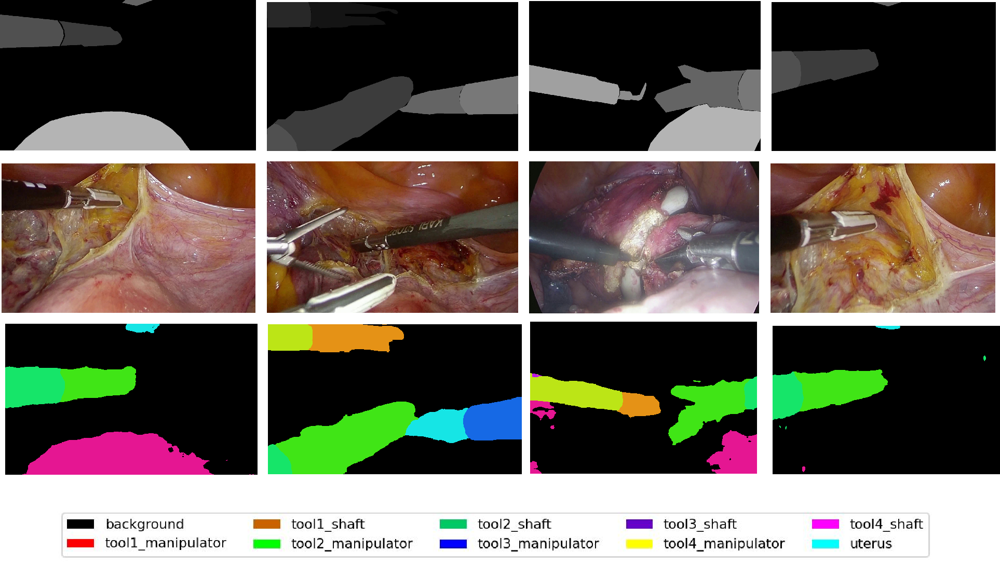
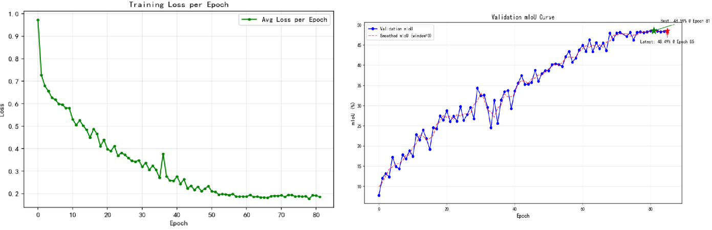

# Baseon_HrNet
# 基于 HRNet 的手术图像分割项目

基于 [HRNet](https://github.com/HRNet/HRNet-Semantic-Segmentation)（High-Resolution Network）实现的手术图像语义分割项目，采用 HRNet + OCR 结构，支持模型训练、验证、checkpoint 自动筛选与可视化。

## 📁 仓库文件说明

```
.
├── models/                                        # HRNet 相关模型定义代码
├── tools/                                         # 训练、验证及可视化工具脚本
├── best.pth                                       # 训练过程中自动筛选出的最优 checkpoint 权重文件
├── hrnet.txt                                      # 本次训练的结果文本记录
├── seg_hrnet_ocr_w18_surgery_one.yaml             # 模型训练配置文件
├── vis1.png                                       # 模型推理输出的可视化结果图片
└── vis2.png                                       # 模型推理输出的可视化结果图片
```

## 🔍 模块说明

| 文件 / 目录 | 说明 |
| --- | --- |
| `models/` | 存放 HRNet 相关模型定义代码 |
| `tools/` | 包含训练、验证及可视化工具脚本 |
| `best.pth` | 训练过程中自动筛选出的最优 checkpoint 二进制权重文件 |
| `hrnet.txt` | 本次训练的结果文本记录 |
| `seg_hrnet_ocr_w18_surgery_one.yaml` | 模型训练配置文件 |
| `vis1.png` / `vis2.png` | 模型推理输出的可视化结果图片 |

## 🧠 模型结构

- **主干网络**：HRNet-W18
- **分割头**：OCR（Object-Contextual Representations）
- **任务**：手术图像语义分割

## 🚀 快速开始

### 环境依赖

> TODO：补充 Python、PyTorch、CUDA 版本及依赖安装命令

```bash
# 示例
pip install -r requirements.txt
```

### 模型训练

使用配置文件 `seg_hrnet_ocr_w18_surgery_one.yaml` 启动训练：

```bash
# 示例（具体命令请根据 tools/ 下脚本调整）
python tools/train.py --cfg seg_hrnet_ocr_w18_surgery_one.yaml
```

训练过程中会自动筛选最优 checkpoint，并保存为 `best.pth`。

### 模型验证 / 推理

> TODO：补充验证与推理命令

```bash
# 示例
python tools/val.py --cfg seg_hrnet_ocr_w18_surgery_one.yaml --weight best.pth
```

### 结果可视化

> TODO：补充可视化脚本调用方式

```bash
# 示例
python tools/vis.py --cfg seg_hrnet_ocr_w18_surgery_one.yaml --weight best.pth
```

可视化结果见 `vis1.png`、`vis2.png`。

## 📊 训练结果

训练结果记录于 `hrnet.txt`。

> TODO：可在此处补充关键指标（mIoU、Accuracy 等）与 `vis1.png` / `vis2.png` 的效果展示

| 可视化结果 |
| --- |
|  |
|  |

## 🏆 最优权重

训练过程中自动筛选出的最优 checkpoint 已保存为 **`best.pth`**。


## 🙏 致谢

本项目基于 [HRNet-Semantic-Segmentation](https://github.com/HRNet/HRNet-Semantic-Segmentation) 实现，感谢原作者的开源工作。
